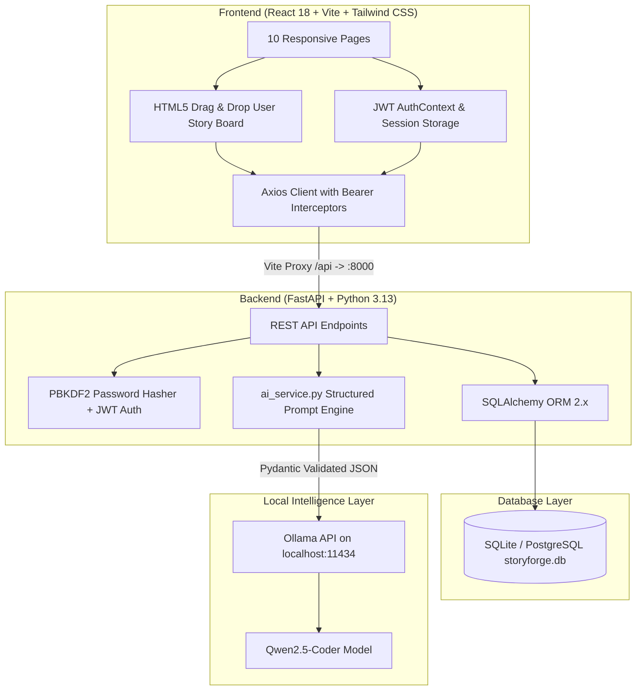

# StoryForge AI 🚀
### AI-Powered User Story Mapping & Agile Planning Platform

[](https://react.dev/)
[](https://tailwindcss.com/)
[](https://fastapi.tiangolo.com/)
[](https://www.sqlalchemy.org/)
[](https://ollama.com/)
[](LICENSE)

**StoryForge AI** is an enterprise-grade Agile planning platform that decomposes natural-language software requirements into structured 2D User Story Maps (Epics, Activities, Tasks, Stories), testable Gherkin acceptance criteria, and optimized Sprint plans using local Generative AI.

---

## 🌟 Key Features

### 1. 🧠 AI Requirement Analyzer
- Ingests raw, unstructured project descriptions.
- Automatically isolates the **Core Problem Statement**, **Strategic Objectives**, **Target User Personas**, and **Numbered Functional Requirements (FR-1, FR-2...)**.
- Persists validated analyses directly into the project database.

### 2. 🗺️ Interactive 2D User Story Mapping Board
- Organizes requirements along Jeff Patton's two-dimensional story mapping framework:
  - **Horizontal Backbone:** Epics → User Activities → User Tasks.
  - **Vertical Prioritization:** User Stories arranged under tasks and sliced by Release (*MVP Release, Release 2.0*).
- **Native HTML5 Drag & Drop:** Move stories between task columns and release swimlanes seamlessly.
- Standard Agile template enforced:
  > *As a [type of user], I want [some functionality], So that [business value].*
- Story points estimation (Fibonacci: 1, 2, 3, 5, 8, 13, 21) and priority levels (*Low, Medium, High, Critical*).

### 3. 🪄 AI Story Improver & Agile Coach
- Evaluates stories against the industry-standard **INVEST** criteria (*Independent, Negotiable, Valuable, Estimable, Small, Testable*).
- Generates a **Story Clarity Score (1–100)** with constructive critique.
- Auto-generates **Gherkin Given-When-Then** acceptance tests.
- Uncovers missing requirements and surfaces unhandled edge cases.
- **1-Click Apply:** Directly updates the story record in the database.

### 4. ⏱️ AI Sprint Planner & Velocity Manager
- Visual **Capacity Utilization Meter** comparing assigned story points against team velocity.
- Interactive backlog queue drawer with quick sprint assignment and unassignment.
- **AI Sprint Optimizer:** Proposes balanced sprint groupings based on story points and priorities with explanatory rationale.

### 5. 📊 Executive Agile Portfolio Dashboard
- High-level KPIs: Total Projects, Epics, Stories, and Story Points Burned.
- Visual story completion ratio bar and velocity progress meter.
- Recent projects table with direct navigation pills to Analyzer, Story Map, and Sprints.

### 6. 📁 Multi-Format Data Export
- **User Story Map (CSV):** Formatted for instant import into Jira, Trello, Azure DevOps, or Excel.
- **Sprint Schedule (CSV):** Iteration breakdown with story point allocations.
- **Full Project Backup (JSON):** Complete relational database snapshot.

### 7. 🔒 100% Privacy-First & Zero Cloud API Costs
- Powered by local **Ollama** running instruction-following models (e.g. `qwen2.5-coder`).
- No proprietary customer requirements are sent to external cloud APIs.

---

## 🏗️ Architecture Blueprint



---

## 🛠️ Technology Stack

| Layer | Technologies |
|---|---|
| **Frontend** | React 18, Vite, Tailwind CSS, Lucide React, Axios, React Router v6 |
| **Backend** | Python 3.10+, FastAPI, Pydantic v2, SQLAlchemy ORM, Uvicorn |
| **Database** | SQLite (Default for zero-config dev) / PostgreSQL compatible |
| **Security** | JWT (JSON Web Tokens), PBKDF2-HMAC-SHA256 password hashing (100,000 rounds) |
| **Local AI** | Ollama, Qwen2.5-Coder (or Llama 3 / Mistral) |
| **Deployment** | Vercel (Frontend), Render (Backend), GitHub |

---

## 📁 Project Directory Structure

```text
StoryForge-AI/
├── backend/
│   ├── routes/
│   │   ├── auth.py              # /api/auth (register, login, me)
│   │   ├── export.py            # /api/export (CSV maps, CSV sprints, JSON backup)
│   │   ├── improver.py          # /api/improver (INVEST review, Gherkin criteria)
│   │   ├── projects.py          # /api/projects (CRUD & stats calculation)
│   │   ├── requirements.py      # /api/requirements (AI analysis & status)
│   │   ├── sprints.py           # /api/sprints (sprint planning & assignment)
│   │   └── stories.py           # /api/stories (story mapping CRUD & reordering)
│   ├── ai_service.py            # Ollama client, prompts & Pydantic response validators
│   ├── auth.py                  # Password hashing & JWT token generation
│   ├── database.py              # SQLAlchemy session setup
│   ├── main.py                  # FastAPI entry point & CORS configuration
│   ├── models.py                # Database models (7 relational tables)
│   ├── schemas.py               # Pydantic request/response schemas
│   ├── test_backend.py          # Automated API test suite
│   ├── requirements.txt         # Python dependencies
│   └── .env.example
├── frontend/
│   ├── public/
│   ├── src/
│   │   ├── components/          # Reusable UI widgets (Navbar, Sidebar, Modals, Badges)
│   │   ├── context/             # AuthContext (JWT session management)
│   │   ├── pages/               # 10 Application Pages
│   │   │   ├── LandingPage.jsx
│   │   │   ├── LoginPage.jsx
│   │   │   ├── RegisterPage.jsx
│   │   │   ├── DashboardPage.jsx
│   │   │   ├── CreateProjectPage.jsx
│   │   │   ├── RequirementAnalysisPage.jsx
│   │   │   ├── StoryMappingBoardPage.jsx
│   │   │   ├── StoryImproverPage.jsx
│   │   │   ├── SprintPlanningPage.jsx
│   │   │   └── ProjectSettingsPage.jsx
│   │   ├── services/            # Axios API clients & export utilities
│   │   ├── App.jsx              # Main routing & protected route guard
│   │   ├── index.css            # Tailwind directives & custom CSS
│   │   └── main.jsx
│   ├── index.html
│   ├── package.json
│   ├── tailwind.config.js
│   └── vite.config.js
├── .gitignore
└── README.md
```

---

## ⚡ Quick Start Guide

### Prerequisites
- [Node.js](https://nodejs.org/) (v18+)
- [Python](https://www.python.org/) (v3.10+)
- [Ollama](https://ollama.com/) (Optional, for local AI generation)

---

### 1. Start the Backend API

```bash
# Navigate to backend directory
cd StoryForge-AI/backend

# Install Python dependencies
pip install -r requirements.txt

# Start FastAPI server
python main.py
```

The backend server will start at `http://127.0.0.1:8000`.  
Interactive Swagger documentation is available at `http://127.0.0.1:8000/docs`.

---

### 2. Start the Frontend Application

Open a second terminal window:

```bash
# Navigate to frontend directory
cd StoryForge-AI/frontend

# Install node dependencies
npm install

# Start Vite dev server
npm run dev
```

Open your browser and navigate to `http://localhost:5173`.

---

### 3. Start Local AI Engine (Optional)

To enable live local AI story generation and analysis:

```bash
# Start Ollama service
ollama serve

# Pull the instruction model
ollama pull qwen2.5-coder
```

*(If Ollama is not running, the application will display a helpful offline banner while allowing full manual story mapping, sprint planning, and CSV/JSON export functionality).*

---

## 📖 Application Pages Guide

| # | Page | Route | Description |
|---|---|---|---|
| 1 | **Landing Page** | `/` | Hero section, interactive 2D story map preview mockup, feature showcase, and auth CTAs. |
| 2 | **Login Page** | `/login` | JWT credential authentication with error handling. |
| 3 | **Registration Page** | `/register` | Account signup with password strength validation. |
| 4 | **Dashboard** | `/dashboard` | Portfolio KPIs, story completion ratios, points burnup, and recent projects table. |
| 5 | **Create Project** | `/projects/new` | Project setup wizard with target personas and instant AI pipeline option. |
| 6 | **AI Requirement Analyzer** | `/projects/:id/analyze` | Natural-language spec deconstruction into problem statements, objectives, and functional requirements. |
| 7 | **Visual Story Map Board** | `/projects/:id/map` | 2D drag-and-drop story board (Epics → Activities → Tasks → Stories) with release slicing. |
| 8 | **AI Story Improver** | `/projects/:id/improve` | INVEST quality checklist, clarity scoring (1-100), and Gherkin acceptance criteria generation. |
| 9 | **Sprint Planning** | `/projects/:id/sprints` | Velocity capacity meters, backlog drawer, and AI sprint clustering. |
| 10 | **Project Settings & Export** | `/projects/:id/settings` | Metadata configuration, CSV story map export, CSV sprint export, and full JSON backup. |

---

## 🌐 Production Deployment

- **Frontend on Vercel:** Import your GitHub repo, set Root Directory to `frontend`, Framework to `Vite`, and set environment variable `VITE_API_URL` to your live backend address.
- **Backend on Render:** Create a free Web Service, set Root Directory to `backend`, Build Command to `pip install -r requirements.txt`, and Start Command to `uvicorn main:app --host 0.0.0.0 --port $PORT`.

---

## 📄 License

This project is licensed under the MIT License — free for personal, commercial, and educational use.
